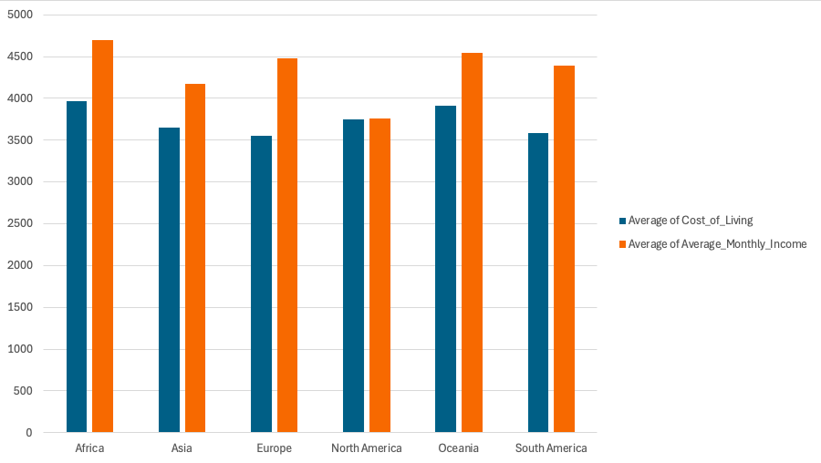
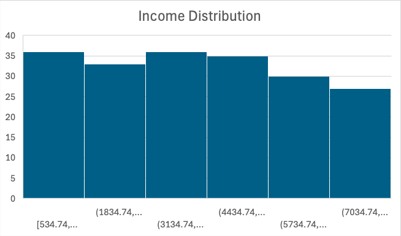
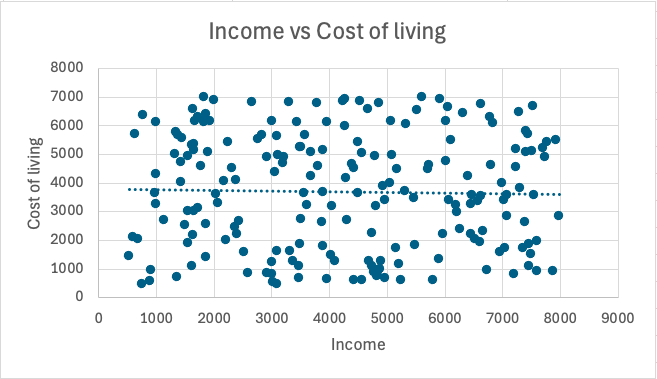

# MIS-311
MIS 311 | Introduction to Business Analytics | Data Analysis Projects

# Cost of Living Analysis

## 1. Data Overview

This project conducts Exploratory Data Analysis (EDA)
on a Cost of Living dataset covering 12 countries
from 2000 to 2023.

The analysis examines income and living-cost patterns
and explores their variation across observations
and geographical regions.

## 2. Dataset Description

| Variable | Description |
|---|---|
| Country | Country name |
| Year | Observation year |
| Average_Monthly_Income | Average monthly income |
| Cost_of_Living | Living cost |
| Region | Geographical region |

Initial observations: 201

Cleaned observations: 197

Countries: 12

Period: 2000–2023

## 4. Data Cleaning

The cleaning process included:

- Removal of 2 excess exact duplicate records.
- Identification of 2 missing income values.
- Completion of 2 missing region values.
- Validation of the cleaned dataset.

Missing income values were retained as blank
and excluded from calculations involving income.

## 5. Descriptive Statistics

| Statistic | Monthly Income | Cost of Living |
|---|---:|---:|
| Count | 197 | 197 |
| Mean | 4243.97 | 3697.51 |
| Median | 4266.46 | 3649.03 |
| Std. Dev. | 2127.41 | 1990.70 |

## 6. Key Insights

### Insight 1: Data Dispersion

The dataset demonstrates substantial variation
in both income and living costs across observations.
Averages alone may conceal important differences.

### Insight 2: Relationship Between Variables

The Pearson correlation is approximately -0.026,
indicating almost no linear relationship
within the available observations.

## 7. Data Visualizations

### Regional Comparison

### Income Distribution

### Income vs. Cost of Living

## 8. Tools Used

- Microsoft Excel
- Exploratory Data Analysis
- Data Visualization

## 9. Limitations

The provided dataset does not specify
the currency unit or the original source metadata.
Therefore, conclusions are limited to
the numerical patterns within the dataset.

## 10. Project Structure

- dataset/: Cleaned and analysis data
- images/: Data visualizations
- report/: Final report
- references/: References and source notes

## 11. References

Original data source information should be added
when provided by the course instructor.

---

**MIS 311 | Introduction to Business Analytics**
